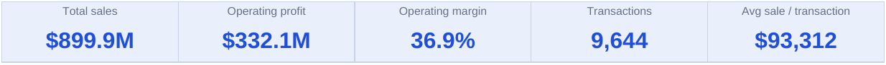
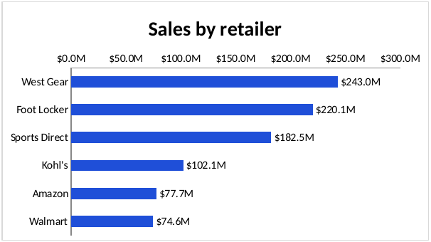
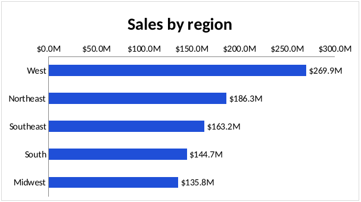
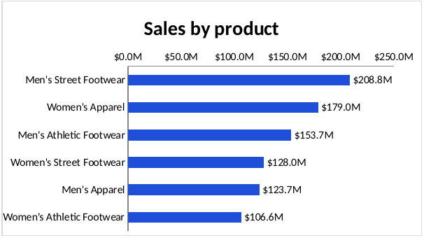
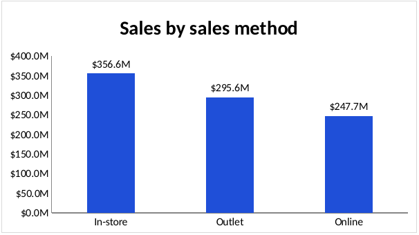
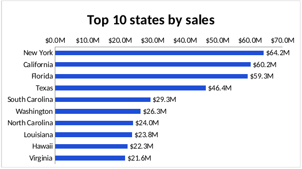
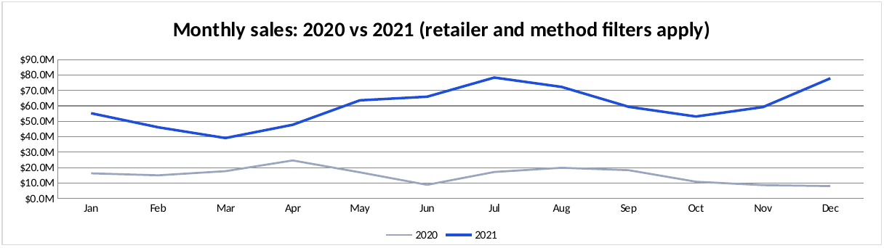
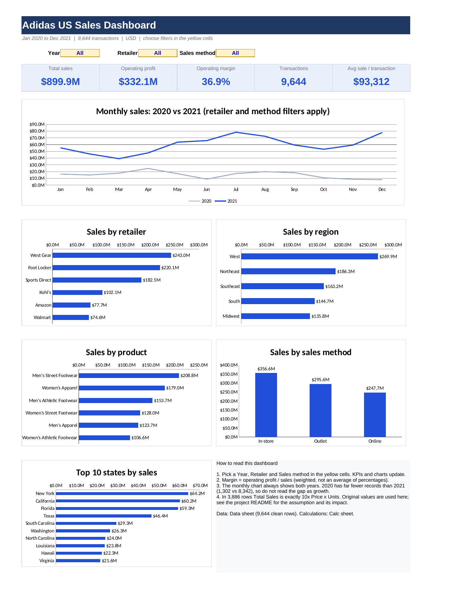
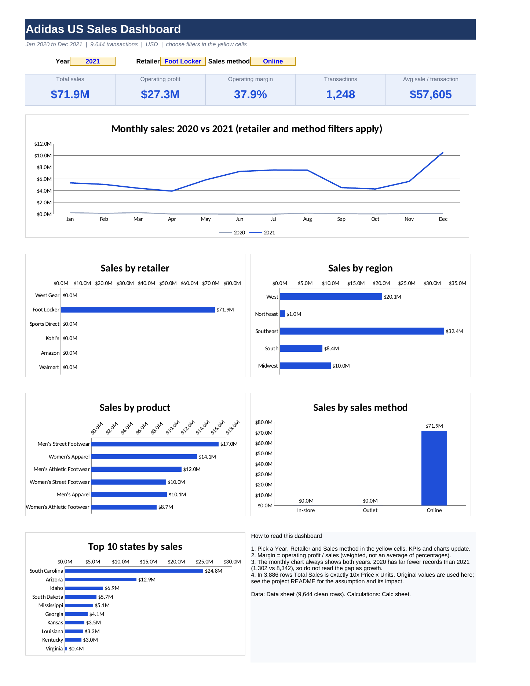
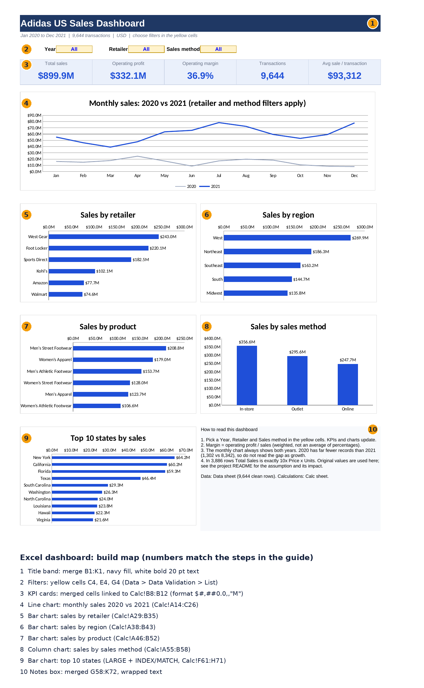

# Adidas US Sales: Exploratory Data Analysis Report

Author: Gautam Kurpatwar | Data: Adidas US sales, 1 Jan 2020 to 31 Dec 2021 | Tools: Python (pandas), Excel

## Contents

1. [Purpose and scope](#1-purpose-and-scope)
2. [Data overview](#2-data-overview)
3. [Data quality assessment](#3-data-quality-assessment)
4. [Univariate analysis](#4-univariate-analysis)
5. [Relationships between variables](#5-relationships-between-variables)
6. [Segment analysis](#6-segment-analysis)
7. [Time analysis](#7-time-analysis)
8. [Cross-segment analysis](#8-cross-segment-analysis)
9. [Sensitivity of the conclusions to the Total Sales issue](#9-sensitivity-of-the-conclusions-to-the-total-sales-issue)
10. [Dashboard views](#10-dashboard-views)
11. [Key insights](#11-key-insights)
12. [Recommendations](#12-recommendations)
13. [Limitations and next steps](#13-limitations-and-next-steps)

## 1. Purpose and scope

This report documents the exploratory data analysis (EDA) of the Adidas US sales dataset. The goals are to understand the structure and quality of the data, describe the distributions and relationships between variables, and answer these business questions:

1. Which retailers, regions, states and products drive sales and profit?
2. Which sales method is the most profitable?
3. How do sales and margin change over time?
4. Where is margin high but volume low (growth opportunities), and where is margin weakest?

All money values are in US dollars. Margin is always total operating profit divided by total sales for the group (a weighted figure), never the average of the Operating Margin column.

## 2. Data overview

| Item | Detail |
|---|---|
| Source file | Adidas_US_Sales_Datasets.xlsx |
| Raw rows | 9,648 |
| Clean rows used in this report | 9,644 |
| Columns | 13 (plus derived fields Year, Month, Quarter, Weekday, Units Adjusted) |
| Period | 01 Jan 2020 to 31 Dec 2021 |
| Retailers | 6 |
| Regions | 5 |
| States / cities | 50 / 52 |
| Products | 6 |
| Sales methods | 3 (In-store, Online, Outlet) |

Overall results: total sales $899.9M, total operating profit $332.1M, overall margin 36.9%, 9,644 transactions, average sale $93,312 per transaction.

*Figure 2.1: Headline KPIs (Excel dashboard).*

## 3. Data quality assessment

| Check | Result | Action |
|---|---|---|
| Title block and blank rows above the table | Headers started in row 5, column B | Removed; headers placed in row 1 |
| Missing values | None in any of the 13 columns | None needed |
| Exact duplicate rows | None | None needed |
| Spelling, case and space variants in text columns | None | None needed |
| Retailer ID type | Stored as a number | Stored as text (it is an identifier) |
| Units Sold = 0 (and Total Sales = 0) | 4 rows | Removed; kept on a separate sheet |
| Operating Profit = Total Sales x Operating Margin | Holds in 100% of rows | None needed |
| Total Sales = Price x Units Sold | Fails in 3,886 rows, always by exactly a factor of 10 | Original values kept; flagged; see Section 9 |
| Retailer ID uniqueness | 4 IDs shared across 6 retailers | Retailer name used as the key |
| City names across states | Repeated (for example Portland, Charleston) | State plus City used for city analysis |
| Date range | 2020-01-01 to 2021-12-31, all valid | None needed |

### The Total Sales issue in detail

In 3,886 rows (40% of records) Total Sales is exactly 10 times Price x Units Sold. These rows hold 96% of all sales dollars. Operating Profit is consistent with Total Sales in every row, so Units Sold looks understated by a factor of 10 in the flagged rows. The analysis keeps the original Total Sales and Operating Profit and uses Units Adjusted = Total Sales / Price for volume. This is an assumption to confirm with the data owner. By sales method the flagged rows are: In-store 1,740 of 1,740 (every record), Outlet 1,145 of 3,017, Online 1,001 of 4,887.

### Coverage by retailer

| Retailer | First invoice | Last invoice | Records |
|---|---|---|---|
| Amazon | 2021-01-13 | 2021-12-31 | 949 |
| Foot Locker | 2020-01-01 | 2021-12-31 | 2,633 |
| Kohl's | 2020-12-28 | 2021-12-25 | 1,030 |
| Sports Direct | 2020-05-24 | 2021-12-25 | 2,032 |
| Walmart | 2020-04-17 | 2021-12-16 | 626 |
| West Gear | 2020-01-02 | 2021-12-23 | 2,374 |

Amazon has no 2020 records, and Kohl's starts at the very end of 2020, so retailer comparisons across years are not like for like.

## 4. Univariate analysis

### Descriptive statistics

| Statistic | Price per Unit | Units Adjusted | Total Sales | Operating Profit | Operating Margin |
|---|---|---|---|---|---|
| mean | 45.22 | 1,854.85 | 93,312.12 | 34,439.52 | 42.0% |
| std | 14.71 | 2,536.16 | 141,932.73 | 54,199.82 | 10.0% |
| min | 7.00 | 6.00 | 160.00 | 75.20 | 10.0% |
| 25% | 35.00 | 111.00 | 4,261.25 | 1,924.82 | 35.0% |
| 50% | 45.00 | 203.00 | 9,581.00 | 4,374.36 | 41.0% |
| 75% | 55.00 | 3,250.00 | 150,000.00 | 52,062.50 | 49.0% |
| max | 110.00 | 12,750.00 | 825,000.00 | 390,000.00 | 80.0% |
| skewness | 0.36 | 1.34 | 1.84 | 2.23 | 0.23 |

How to read this:

- **Price per Unit** is close to symmetric (mean $45.22, median $45, skewness 0.36), ranging from $7 to $110.
- **Total Sales and Operating Profit are strongly right-skewed** (skewness 1.84 and 2.23). The mean sale ($93,312) is about ten times the median ($9,581), so a small number of very large orders drive most revenue.
- **Units Adjusted** has a median of 203 but a 75th percentile of 3,250. The spread between the median and the 75th percentile shows many small transactions alongside a group of very large orders.
- **Operating Margin** per transaction ranges from 10% to 80% (mean 42.3%, median 41%). The sales-weighted margin is lower, at 36.9%, because large orders carry lower margins.

### Outliers

Using the 1.5 x IQR rule, 653 transactions (6.8%) are outliers on Total Sales and 706 (7.3%) on Operating Profit. They are genuine large orders, not errors, so they were kept. Removing them would remove the main revenue driver and misstate every total.

## 5. Relationships between variables

| Correlation | Price per Unit | Units Adjusted | Total Sales | Operating Profit | Operating Margin |
|---|---|---|---|---|---|
| Price per Unit | 1.00 | 0.25 | 0.44 | 0.39 | -0.14 |
| Units Adjusted | 0.25 | 1.00 | 0.94 | 0.92 | -0.38 |
| Total Sales | 0.44 | 0.94 | 1.00 | 0.96 | -0.36 |
| Operating Profit | 0.39 | 0.92 | 0.96 | 1.00 | -0.21 |
| Operating Margin | -0.14 | -0.38 | -0.36 | -0.21 | 1.00 |

- Total Sales moves almost one for one with volume (0.94 with Units Adjusted) and with profit (0.96). Sales volume, not price, explains revenue.
- Price has only a moderate link to sales (0.44) and a weak negative link to margin (-0.14).
- **Margin falls as deals get bigger**: -0.38 with units and -0.36 with total sales. This points to volume discounts or lower-margin bulk channels. Correlation shows association, not cause.
- Items priced above $60 earn a margin of 34.9%, against 38.3% for items priced at $30 or less.

## 6. Segment analysis

### By retailer

*Figure 6.1: Sales by retailer (Excel dashboard).*

| Retailer | Sales | Share | Profit | Margin | Transactions | Avg sale |
|---|---|---|---|---|---|---|
| West Gear | $243.0M | 27.0% | $85.7M | 35.3% | 2,374 | $102,344 |
| Foot Locker | $220.1M | 24.5% | $80.7M | 36.7% | 2,633 | $83,591 |
| Sports Direct | $182.5M | 20.3% | $74.3M | 40.7% | 2,032 | $89,799 |
| Kohl's | $102.1M | 11.3% | $36.8M | 36.0% | 1,030 | $99,141 |
| Amazon | $77.7M | 8.6% | $28.8M | 37.1% | 949 | $81,875 |
| Walmart | $74.6M | 8.3% | $25.8M | 34.6% | 626 | $119,103 |

The top three retailers (West Gear, Foot Locker, Sports Direct) hold 71.7% of sales. Sports Direct has the best margin (40.7%) and a larger share of profit (22.4%) than of sales (20.3%). Walmart has the lowest margin (34.6%).

### By region

*Figure 6.2: Sales by region.*

| Region | Sales | Share | Profit | Margin | Transactions | Avg sale |
|---|---|---|---|---|---|---|
| West | $269.9M | 30.0% | $89.6M | 33.2% | 2,448 | $110,271 |
| Northeast | $186.3M | 20.7% | $68.0M | 36.5% | 2,376 | $78,419 |
| Southeast | $163.2M | 18.1% | $60.6M | 37.1% | 1,224 | $133,310 |
| South | $144.7M | 16.1% | $61.1M | 42.3% | 1,728 | $83,717 |
| Midwest | $135.8M | 15.1% | $52.8M | 38.9% | 1,868 | $72,698 |

The West is the largest region but has the lowest margin. The South is the second-smallest region by sales and earns the highest margin (42.3%).

### By product

*Figure 6.3: Sales by product.*

| Product | Sales | Share | Profit | Margin | Transactions | Avg sale |
|---|---|---|---|---|---|---|
| Men's Street Footwear | $208.8M | 23.2% | $82.8M | 39.7% | 1,610 | $129,706 |
| Women's Apparel | $179.0M | 19.9% | $68.7M | 38.3% | 1,608 | $111,343 |
| Men's Athletic Footwear | $153.7M | 17.1% | $51.8M | 33.7% | 1,610 | $95,449 |
| Women's Street Footwear | $128.0M | 14.2% | $45.1M | 35.2% | 1,608 | $79,604 |
| Men's Apparel | $123.7M | 13.7% | $44.8M | 36.2% | 1,606 | $77,041 |
| Women's Athletic Footwear | $106.6M | 11.8% | $39.0M | 36.6% | 1,602 | $66,562 |

Men's Street Footwear leads on sales and also has the best margin among the six products. Men's Athletic Footwear is third on sales but has the weakest margin (33.7%).

### By sales method

*Figure 6.4: Sales by sales method.*

| Sales method | Sales | Share | Profit | Margin | Transactions | Avg sale |
|---|---|---|---|---|---|---|
| In-store | $356.6M | 39.6% | $127.6M | 35.8% | 1,740 | $204,968 |
| Outlet | $295.6M | 32.8% | $108.0M | 36.5% | 3,017 | $97,973 |
| Online | $247.7M | 27.5% | $96.6M | 39.0% | 4,887 | $50,680 |

In-store has the most sales but the fewest transactions and the largest average sale. Online has the most transactions, the smallest average sale and the best margin. Note that this ranking depends on the Total Sales issue (Section 9).

### By state

*Figure 6.5: Top 10 states by sales.*

Top 10 states by sales:

| State | Sales | Share | Profit | Margin | Transactions | Avg sale |
|---|---|---|---|---|---|---|
| New York | $64.2M | 7.1% | $23.3M | 36.3% | 360 | $178,414 |
| California | $60.2M | 6.7% | $19.3M | 32.1% | 432 | $139,292 |
| Florida | $59.3M | 6.6% | $20.9M | 35.3% | 360 | $164,677 |
| Texas | $46.4M | 5.2% | $18.7M | 40.3% | 432 | $107,314 |
| South Carolina | $29.3M | 3.3% | $11.3M | 38.7% | 144 | $203,372 |
| Washington | $26.3M | 2.9% | $7.0M | 26.6% | 144 | $182,852 |
| North Carolina | $24.0M | 2.7% | $9.8M | 40.7% | 144 | $166,365 |
| Louisiana | $23.8M | 2.6% | $9.4M | 39.7% | 216 | $109,957 |
| Hawaii | $22.3M | 2.5% | $5.8M | 26.3% | 144 | $154,739 |
| Virginia | $21.6M | 2.4% | $7.7M | 35.8% | 216 | $99,884 |

The top 5 states account for 28.8% of sales and the top 10 for 41.9%. About 31 of the 50 states are needed to reach 80% of sales.

Highest and lowest margins:

| Highest margin | Margin | Sales | Lowest margin | Margin  | Sales  |
|---|---|---|---|---|---|
| Alabama | 51.9% | $17.6M | Hawaii | 26.3% | $22.3M |
| Tennessee | 47.0% | $18.1M | Washington | 26.6% | $26.3M |
| Michigan | 43.7% | $18.6M | Massachusetts | 30.3% | $11.1M |
| Idaho | 42.1% | $19.3M | Alaska | 30.5% | $14.8M |
| Nebraska | 41.1% | $5.9M | California | 32.1% | $60.2M |

High margin but low volume (margin of 40% or more and sales under $11M): West Virginia, Pennsylvania, Illinois, Missouri, Nebraska. These are candidates for growth. Alabama, Tennessee, Michigan and Idaho have the highest margins among mid-sized states. Hawaii and Washington have the highest average prices yet the lowest margins, which suggests discounting or higher costs at premium prices.

## 7. Time analysis

### By year

*Figure 7.1: Monthly sales, 2020 against 2021. The 2020 line is low because 2020 has far fewer records.*

| Year | Sales | Profit | Margin | Transactions | Avg sale |
|---|---|---|---|---|---|
| 2020 | $182.1M | $63.4M | 34.8% | 1,302 | $139,847 |
| 2021 | $717.8M | $268.8M | 37.4% | 8,342 | $86,049 |

**The jump from 2020 to 2021 is not real growth.** 2020 has 1,302 records (about 110 a month) against 8,342 in 2021 (about 700 a month), Amazon has no 2020 data and Kohl's starts in late December 2020. Treat 2021 as the reliable year.

### 2021 monthly trend

| Month | Sales | Profit | Margin | Transactions |
|---|---|---|---|---|
| 1 | $55.2M | $19.3M | 35.0% | 711 |
| 2 | $46.1M | $16.2M | 35.1% | 662 |
| 3 | $39.1M | $14.6M | 37.2% | 671 |
| 4 | $47.7M | $18.3M | 38.3% | 711 |
| 5 | $63.6M | $24.1M | 37.9% | 725 |
| 6 | $65.9M | $24.4M | 37.0% | 665 |
| 7 | $78.3M | $29.1M | 37.2% | 670 |
| 8 | $72.3M | $27.1M | 37.5% | 714 |
| 9 | $59.4M | $23.9M | 40.2% | 728 |
| 10 | $53.1M | $20.9M | 39.5% | 728 |
| 11 | $59.2M | $22.0M | 37.1% | 690 |
| 12 | $77.8M | $28.9M | 37.1% | 667 |

### 2021 quarters

| Quarter | Sales | Margin |
|---|---|---|
| Q1 | $140.5M | 35.6% |
| Q2 | $177.2M | 37.7% |
| Q3 | $210.0M | 38.2% |
| Q4 | $190.1M | 37.8% |

Sales peak in July and December and are lowest in March. Margin is lowest in Q1 (35.6%) and highest in Q3 (38.2%).

### By weekday (both years)

| Weekday | Sales | Margin | Transactions |
|---|---|---|---|
| Friday | $146.7M | 37.1% | 1,424 |
| Thursday | $145.7M | 36.8% | 1,343 |
| Tuesday | $137.1M | 36.6% | 1,490 |
| Wednesday | $120.1M | 37.4% | 1,346 |
| Sunday | $120.0M | 37.0% | 1,390 |
| Saturday | $117.9M | 36.3% | 1,405 |
| Monday | $112.3M | 37.2% | 1,246 |

Friday is the strongest day and Monday the weakest, with about 31% more sales on Fridays. The gap comes from the number of transactions and bigger average orders, while margin is almost the same across days (36.3% to 37.4%).

## 8. Cross-segment analysis

### Sales by retailer and sales method

| Retailer | In-store | Online | Outlet |
|---|---|---|---|
| Amazon | $22.4M | $28.9M | $26.4M |
| Foot Locker | $76.5M | $72.9M | $70.6M |
| Kohl's | $29.6M | $31.0M | $41.6M |
| Sports Direct | $55.0M | $59.2M | $68.2M |
| Walmart | $16.4M | $15.1M | $43.1M |
| West Gear | $156.7M | $40.5M | $45.7M |

West Gear's In-store sales ($156.7M) are 64.5% of its own sales and 43.9% of all In-store sales, which is a concentration risk. Walmart is Outlet-heavy (57.8% of its sales).

### Margin by retailer and sales method

| Retailer | In-store | Online | Outlet |
|---|---|---|---|
| Amazon | 37.4% | 40.5% | 33.1% |
| Foot Locker | 36.7% | 38.1% | 35.2% |
| Kohl's | 35.8% | 35.5% | 36.6% |
| Sports Direct | 37.4% | 39.8% | 44.2% |
| Walmart | 30.0% | 40.0% | 34.4% |
| West Gear | 35.1% | 40.7% | 31.1% |

Sports Direct earns its best margin in Outlet (44.2%). Walmart In-store (30.0%) and West Gear Outlet (31.1%) are the weakest combinations.

### Margin by region and product

| Region | Men's Apparel | Men's Athletic Footwear | Men's Street Footwear | Women's Apparel | Women's Athletic Footwear | Women's Street Footwear |
|---|---|---|---|---|---|---|
| Midwest | 39.9% | 34.8% | 39.1% | 43.7% | 37.1% | 35.7% |
| Northeast | 31.7% | 35.5% | 41.9% | 36.0% | 34.3% | 34.1% |
| South | 36.8% | 38.9% | 40.5% | 49.5% | 46.0% | 40.6% |
| Southeast | 33.9% | 34.3% | 40.6% | 44.1% | 34.1% | 31.7% |
| West | 38.8% | 29.4% | 36.9% | 27.4% | 34.0% | 34.7% |

The weakest pairs are Women's Apparel in the West (27.4%) and Men's Athletic Footwear in the West (29.4%). The strongest is Women's Apparel in the South (49.5%).

### Sales by region and sales method

| Region | In-store | Online | Outlet |
|---|---|---|---|
| Midwest | $59.6M | $40.3M | $36.0M |
| Northeast | $116.0M | $4.6M | $65.7M |
| South | $3.4M | $59.8M | $81.4M |
| Southeast | $72.4M | $83.9M | $6.9M |
| West | $105.4M | $59.1M | $105.5M |

Channel gaps: Northeast Online is only $4.6M, South In-store is $3.4M and Southeast Outlet is $6.9M.

## 9. Sensitivity of the conclusions to the Total Sales issue

If Total Sales were the wrong field and sales were recomputed as Price x Units Sold, total sales would be $120.2M instead of $899.9M. The effect on the main conclusions:

| Sales method | Sales (original) | Rank | Sales (recomputed) | Rank  |
|---|---|---|---|---|
| In-store | $356.6M | 1 | $35.7M | 3 |
| Outlet | $295.6M | 2 | $39.5M | 2 |
| Online | $247.7M | 3 | $45.0M | 1 |

- Rankings of regions, products and the top four retailers do not change. Amazon and Walmart swap fifth and sixth place.
- **The sales method ranking flips**: Online becomes first and In-store third.
- Margin percentages do not change, because they come from the Operating Margin column.

The data owner should confirm which field is correct before the sales method conclusions are used for decisions.

## 10. Dashboard views

The findings above are also available as an interactive Excel dashboard (`dashboard/excel/Adidas_US_Sales_Dashboard.xlsx`) and an HTML dashboard (`dashboard/adidas_sales_dashboard.html`). The images below are renders of the Excel dashboard.

*Figure 10.1: Excel dashboard with no filters. It reconciles to the report totals: $899.9M sales, $332.1M profit, 36.9% margin, 9,644 transactions.*

*Figure 10.2: The same dashboard filtered to 2021, Foot Locker and Online: $71.9M sales, $27.3M profit, 37.9% margin, 1,248 transactions. This case was checked against an independent calculation in Python.*

*Figure 10.3: Build map. Each number marks a dashboard element and the cell range or formula behind it (1 title band, 2 filters, 3 KPI cards, 4 trend chart, 5 to 9 bar and column charts, 10 notes box).*

How the dashboard works: the three yellow dropdown cells feed a Calc sheet of SUMIFS tables, and the charts read from those tables. Margin is always total profit divided by total sales. The monthly chart ignores the Year filter on purpose, so both years are always visible.

## 11. Key insights

1. **Concentration:** three retailers produce about 72% of sales, and West Gear alone produces 27%.
2. **Region and margin do not line up:** the West is 30% of sales at a 33.2% margin, while the South is 16% of sales at a 42.3% margin.
3. **Product mix:** Men's Street Footwear is the top product on sales and profit. Men's Athletic Footwear has the weakest margin (33.7%).
4. **Channel trade-off:** In-store has the largest orders, Online the best margin (39.0%) and the most transactions.
5. **Big deals earn lower margins:** margin correlates negatively with units (-0.38) and with price (-0.14).
6. **Seasonality:** 2021 sales peak in July and December and dip in March, and margin is lowest in Q1 and highest in Q3.
7. **Geography:** New York, California and Florida lead on sales. Hawaii, Washington and California have the weakest margins. Alabama, Tennessee, Michigan and Idaho have the strongest.
8. **Data caveat:** 96% of sales dollars sit in rows where Total Sales is 10 times Price x Units, and this changes the sales method ranking.

## 12. Recommendations

1. Protect the three anchor retailers and grow Kohl's, Amazon and Walmart to reduce dependence on them.
2. Review discounts and costs in the West and in premium-price states (Washington, Hawaii, California), starting with Women's Apparel and Men's Athletic Footwear in the West.
3. Scale the high-margin states (Alabama, Tennessee, Michigan, Idaho) and test growth in high-margin, low-volume states such as Nebraska and Missouri.
4. Grow the Online channel where it is weak, especially in the Northeast.
5. Plan inventory and promotions around the July and December peaks and the March dip.
6. Keep investing in Men's Street Footwear and Women's Apparel, and review price and cost for Athletic Footwear.

## 13. Limitations and next steps

**Limitations**

- The Total Sales scale issue (Sections 3 and 9) needs confirmation from the data owner.
- 2020 coverage is far thinner than 2021, so year-on-year comparisons are unreliable.
- Retailer ID is not unique, so only Retailer names are used.
- There are no cost, discount, customer or inventory fields, so the drivers of margin can be described but not proven.
- Correlations show association, not cause.

**Next steps**

- Confirm the correct field with the data owner and re-run the analysis if Total Sales changes.
- Explain the 2020 coverage gap, then compare the two years like for like.
- Test whether discounts explain the low margins in Hawaii, Washington and the West.
- Build a monthly forecast once the coverage issue is resolved.
